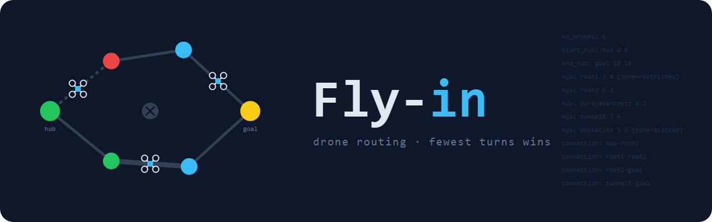

*This project has been created as part of the 42 curriculum by sosanche.*

# Fly-in



## Description

Fly-in moves a group of drones from a start zone to an end zone through a
map of connected zones, in as few turns as possible, following the rules of
each zone and connection.

The program reads a map, checks it for errors, plans a path for each drone
and prints the moves turn by turn.

## Instructions

Requires Python 3.10 or newer.

```
make install                             # create .venv, install flake8, mypy, webcolors
make run MAP=maps/easy/02_simple_fork.txt
make lint                                # flake8 + mypy
make debug                               # run with pdb
make clean                               # remove caches
```

The moves go to stdout and the zone states go to stderr. To see only the
moves, or to count the turns:

```
make run MAP=maps/hard/01_maze_nightmare.txt 2>/dev/null
.venv/bin/python3 main.py maps/hard/01_maze_nightmare.txt 2>/dev/null | wc -l
```

### Results on the provided maps

| Map | Drones | Turns | Target |
|---|---|---|---|
| easy/01_linear_path | 2 | 4 | ≤ 6 |
| easy/02_simple_fork | 4 | 4 | ≤ 8 |
| easy/03_basic_capacity | 4 | 4 | ≤ 6 |
| medium/01_dead_end_trap | 5 | 8 | ≤ 12 |
| medium/02_circular_loop | 6 | 15 | ≤ 15 |
| medium/03_priority_puzzle | 5 | 7 | ≤ 12 |
| hard/01_maze_nightmare | 8 | 13 | ≤ 30 |
| hard/02_capacity_hell | 12 | 16 | ≤ 35 |
| hard/03_ultimate_challenge | 15 | 31 | ≤ 45 |
| challenger/01_the_impossible_dream | 25 | 50 | 45 (optional) |

### Where to find each part

| File | What it does |
|---|---|
| `main.py` | Starts the program and prints the errors |
| `parser.py` | Reads the map file and checks every line |
| `map.py` | Stores zones and connections, finds the path (`find_path`) |
| `zone.py` | A zone: type, color, capacity, cost to enter (`get_cost`) |
| `connection.py` | A connection between two zones and its capacity |
| `drone.py` | A drone: its path and where it is |
| `simulation.py` | Plays the turns (`play_turn`, `move_drone`) and prints them |

### Errors

Any wrong map stops the program with a clear message and the line number:

```
Error: line 3: zone 'a' is repeated
Error: line 4: zone 'c' does not exist
Error: line 3: max_drones must be greater than 0
Error: there is no path from start to end
```

## Algorithm explanation

- Each drone gets its own path with a Dijkstra-like search (`Map.find_path`).
- Cost to enter a zone: normal 1, restricted 2, priority 0.9 (so priority
  zones are preferred). Blocked zones are never used.
- After a drone gets its path, the zones on it become a bit more expensive
  (`load / max_drones`), so the next drones spread over other paths.
- Each turn, every drone tries to move one step. It waits if the next zone
  or the connection is full. Drones are tried again in the same turn, so a
  place freed by another drone can be used right away.
- A move to a restricted zone takes 2 turns: during the first turn the drone
  is on the connection (`D1-a-b`), then it arrives.
- `start_hub` and `end_hub` have no capacity limit.

## Visual representation

- Each move is printed in the color of the zone the drone goes to (from
  `color=` in the map, using `webcolors`). Unknown colors are printed
  without color.
- After each turn, a line on stderr shows how many drones are in each zone,
  for example `zones: start:2 junction:2`, so you can follow the drones step
  by step.

## Example

Input (`maps/easy/02_simple_fork.txt`):

```
nb_drones: 4

start_hub: start 0 0 [color=green]
hub: junction 1 0 [color=yellow max_drones=2]
hub: path_a 2 1 [color=blue]
hub: path_b 2 -1 [color=blue]
end_hub: goal 3 0 [color=red]

connection: start-junction [max_link_capacity=2]
connection: junction-path_a
connection: junction-path_b
connection: path_a-goal
connection: path_b-goal
```

Output (4 turns):

```
D1-junction D2-junction
D1-path_a D2-path_b D3-junction D4-junction
D1-goal D2-goal D3-path_a D4-path_b
D3-goal D4-goal
```

## Resources

- Dijkstra's algorithm: https://en.wikipedia.org/wiki/Dijkstra%27s_algorithm
- Python documentation: https://docs.python.org/3/
- webcolors: https://webcolors.readthedocs.io/
- ANSI color codes: https://en.wikipedia.org/wiki/ANSI_escape_code

I've used ChatGPT to:

- Theory: help me understand the logic.

I've used Claude to:

- Run tests: I've asked it to run normal tests and edge-case tests; thanks to that, I've found errors.
- Speed tips: like having it show type errors earlier to save time.
- To generate the basic make help output
- Readme: to help me organize and structure the readme, as well as make it more visual.